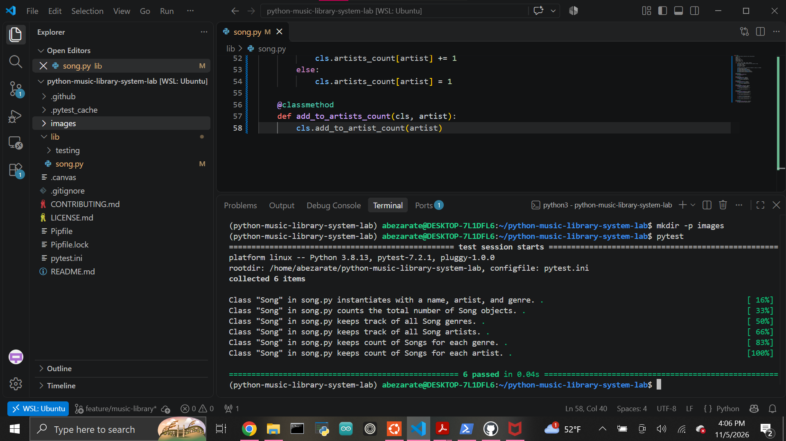

# Music Library System

A Python object-oriented programming project that models a simple music library using instance attributes, class attributes, and class methods.

The `Song` class stores information about individual songs while also tracking information across the entire music library.

## Features

The `Song` class can:

- Store a song's name, artist, and genre
- Track the total number of songs created
- Track unique genres
- Track unique artists
- Count how many songs belong to each genre
- Count how many songs belong to each artist

## Song Attributes

Each individual `Song` object contains:

- `name`
- `artist`
- `genre`

Example:

```python
song = Song("Halo", "Beyonce", "Pop")

print(song.name)
print(song.artist)
print(song.genre)
```

## Class Attributes

The `Song` class maintains information shared across all song objects.

- `count` - total number of songs created
- `genres` - unique genres
- `artists` - unique artists
- `genre_count` - number of songs belonging to each genre
- `artist_count` / `artists_count` - number of songs belonging to each artist

Example:

```python
Song("99 Problems", "Jay Z", "Rap")
Song("Halo", "Beyonce", "Pop")
Song("Smells Like Teen Spirit", "Nirvana", "Rock")

print(Song.count)
print(Song.genres)
print(Song.artists)
```

## Class Methods

### `add_song_to_count()`

Increases the total song count whenever a new song is created.

### `add_to_genres()`

Adds a genre to the shared genres list while preventing duplicates.

### `add_to_artists()`

Adds an artist to the shared artists list while preventing duplicates.

### `add_to_genre_count()`

Tracks how many songs belong to each genre.

Example:

```python
{
    "Rap": 1,
    "Pop": 2,
    "Rock": 1
}
```

### `add_to_artists_count()`

Tracks how many songs belong to each artist.

Example:

```python
{
    "Beyonce": 2,
    "Jay Z": 1,
    "Nirvana": 1
}
```

## OOP Concepts

This project demonstrates the difference between instance-level and class-level data.

`self` refers to one specific `Song` object.

`cls` refers to the `Song` class and is used to update information shared across all songs.

Class methods are created with the `@classmethod` decorator.

## Technologies

- Python 3.8.13
- Pytest
- Pipenv
- Git
- GitHub

## Setup

Clone the repository:

```bash
git clone git@github.com:Abraham-z14/python-music-library-system-lab.git
cd python-music-library-system-lab
```

Install and enter the Python environment:

```bash
pipenv --python ~/.pyenv/versions/3.8.13/bin/python install
pipenv shell
```

## Testing

Run the automated test suite with:

```bash
pytest
```

Current result:

```text
6 passed
```

## Completed Test Suite



## Project Structure

```text
python-music-library-system-lab/
├── images/
│   └── tests-passing.png
├── lib/
│   ├── song.py
│   └── testing/
├── Pipfile
├── Pipfile.lock
├── pytest.ini
└── README.md
```

## Author

Abraham Zarate